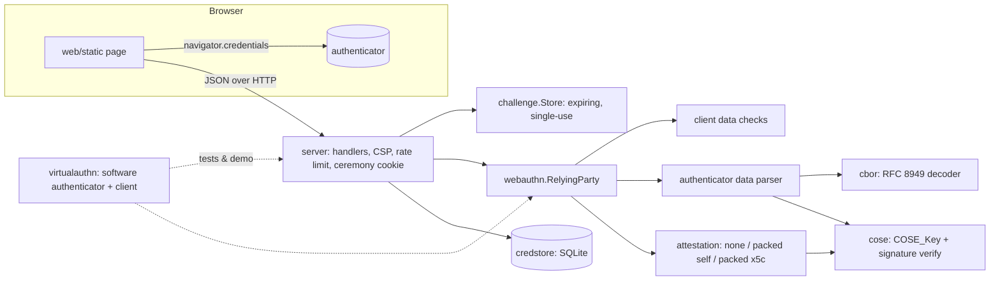

# passkeyd

A WebAuthn (passkey) relying-party library and server in Go. The CBOR decoder,
the COSE key parser and every ceremony check are written in this repository
rather than pulled from a WebAuthn framework. The only third-party module is a
pure-Go SQLite driver.

- **Registration:** attestation formats `none`, `packed` self attestation, and
  `packed` with an `x5c` certificate chain (WebAuthn L3 §8.2.1 certificate rules,
  AAGUID extension, optional trust-anchor chain verification).
- **Authentication:** RP ID hash, UP/UV flags, BE/BS backup-flag consistency,
  signature-counter clone detection, allow-list and user-handle binding.
- **Algorithms:** ES256, ES384, ES512, EdDSA (Ed25519), RS256. Ed448 is refused.
- **Expiring single-use challenge store:** a min-heap keyed by expiry, so each
  operation is O(log n). Credentials are stored in SQLite, and signature
  counters are updated with compare-and-swap.
- **Software virtual authenticator:** creates real ES256/EdDSA/ES384/ES512/RS256
  key pairs and emits CTAP2-canonical attestation objects, so the tests and the
  demo run real cryptography with no browser involved.
- **Published spec vectors:** all 11 credential test vectors in WebAuthn Level 3
  §16 are replayed in the tests, along with the 82 CBOR examples from RFC 7049/8949
  Appendix A.
- **One negative test per verification check:** 34 checks and 84 hostile cases. A
  meta-test fails if any check is left without one.
- **Browser demo:** a small static HTML/JS page with no framework, plus
  [docs/THREAT_MODEL.md](docs/THREAT_MODEL.md).

> Status: a portfolio project written to be read and tested. It has no
> production users, and nobody has audited it.

## Who it is for

- Engineers who want to see how a passkey login is verified, byte by byte, and
  which check stops which attack.
- Go services that need a small RP core with no dependencies and need to test
  their login flows against a scriptable authenticator (`virtualauthn`).
- Security reviewers who want a WebAuthn implementation where each rejection
  has a stable error code (`origin_mismatch`, `sign_count_regression`, ...).

## Architecture



| Package | Role |
|---|---|
| `cbor/` | RFC 8949 decoder/encoder with depth, item and length limits, duplicate-key rejection, CTAP2 canonical mode, and diagnostic notation |
| `cose/` | COSE_Key parsing and encoding (EC2, OKP, RSA), plus signature verification in the formats WebAuthn uses (DER ECDSA) |
| `webauthn/` | Relying party: options, the client data, authenticator data and attestation checks, both ceremonies, typed `VerifyError{Check}` |
| `challenge/` | Generic expiring, single-use store (`Store[T]`) |
| `credstore/` | SQLite repository: migrations, atomic user+credential creation, CAS counter updates, clone flag |
| `server/` | HTTP JSON API, embedded static page, security headers, per-IP rate limit |
| `virtualauthn/` | Software authenticator and client for tests, the demo and lab work |
| `internal/cli`, `cmd/passkeyd` | `serve`, `demo`, `inspect`, `version` |
| `internal/demo` | The offline end-to-end scenario behind `make demo` |
| `web/static` | `index.html`, `app.js`, `style.css`, about 200 lines in total |

[docs/ARCHITECTURE.md](docs/ARCHITECTURE.md) covers the ceremony pipelines, the
CBOR algorithm, the store design and complexity bounds.

## Quickstart

Requires Go 1.27 (and `golangci-lint` v2 for `make check`).

```sh
make check          # gofmt check, go vet, golangci-lint, race tests, coverage gate
make demo           # offline end-to-end demo (no network, no browser)
make run            # serve the browser demo on http://localhost:8080
```

To use the browser demo, open <http://localhost:8080> in a browser that supports
passkeys. WebAuthn treats `localhost` as a secure context, so plain http works there.
Register a username, then sign in with or without typing it.

For any other host, set the RP ID and its exact origins (https is required):

```sh
./bin/passkeyd serve -rp-id example.org -origins https://example.org -db /var/lib/passkeyd.db
```

Every flag has a `PASSKEYD_*` environment variable (see [.env.example](.env.example)).
`passkeyd inspect <hex|base64url>` decodes an attestation object, authenticator
data or any CBOR item:

```text
$ go run ./cmd/passkeyd inspect a363666d74646e6f6e65...   # spec vector 16.2
attestation object (194 bytes)
  fmt: none
  authenticator data (164 bytes)
    rpIdHash:  bfabc37432958b063360d3ad6461c9c4735ae7f8edd46592a5e0f01452b2e4b5
    flags:     0x59 UP|BE|BS|AT
    signCount: 0
    aaguid:    8446ccb9-ab1d-b374-750b-2367ff6f3a1f
    credentialId (32 bytes): -R85HbTJsv3g6nAYnLo_tj9Xm6YSKzOtlP8-wzAIS-Q
    publicKey: {1: 2, 3: -7, -1: 1, -2: h'afefa16f...', -3: h'930a56b8...'}
    publicKey.alg: ES256 (valid)
```

### Library use

```go
rp, _ := webauthn.New(webauthn.Config{RPID: "example.org", Origins: []string{"https://example.org"}})

opts, sess, _ := rp.BeginRegistration(webauthn.User{ID: handle, Name: "alice"}, nil)
// send opts to the browser; keep sess server-side (e.g. in a challenge.Store)
res, err := rp.FinishRegistration(sess, &browserResponse, credentialExists)
if webauthn.CheckOf(err) == webauthn.CheckOrigin { /* phishing attempt */ }
// persist res.Credential

lopts, lsess, _ := rp.BeginLogin(nil, nil) // discoverable passkey login
login, err := rp.FinishLogin(lsess, &assertion, lookupCredential)
// persist login.Credential with compare-and-swap on login.PreviousSignCount
```

## Demo output

This is `make demo` from a real run. The loopback port is replaced with `PORT`.

```text
== 1. WebAuthn Level 3 spec vectors (section 16) ==
  PASS  verified  none-es256                     ES256  attestation=none  trusted=false  credIdLen=32
  PASS  verified  none-es256-crossOrigin         ES256  attestation=none  trusted=false  credIdLen=32
  PASS  verified  none-es256-long-credential-id  ES256  attestation=none  trusted=false  credIdLen=1023
  PASS  verified  none-es256-topOrigin           ES256  attestation=none  trusted=false  credIdLen=32
  PASS  refused   packed-ed448                   Ed448 is not implemented -> algorithm_not_allowed
  PASS  verified  packed-eddsa                   EdDSA  attestation=basic  trusted=true  credIdLen=32
  PASS  verified  packed-es256                   ES256  attestation=basic  trusted=true  credIdLen=32
  PASS  verified  packed-es384                   ES384  attestation=basic  trusted=true  credIdLen=32
  PASS  verified  packed-es512                   ES512  attestation=basic  trusted=true  credIdLen=32
  PASS  verified  packed-rs256                   RS256  attestation=basic  trusted=true  credIdLen=32
  PASS  verified  packed-self-es256              ES256  attestation=self  trusted=false  credIdLen=32

== 2. Ceremonies over HTTP (server http://127.0.0.1:PORT, RP ID "localhost", origin http://localhost:8080, SQLite demo.db) ==
  PASS  accepted  register alice  packed x5c / ES256  algorithm=ES256  attestation=basic  trusted=true
  PASS  accepted  register bob    none / EdDSA  algorithm=EdDSA  attestation=none
  PASS  accepted  register carol  packed self / synced  attestation=self  backupEligible=true
  PASS  accepted  login alice     by username  username=alice  signCount=2
  PASS  accepted  login alice     again, counter grows  signCount=3
  PASS  accepted  login bob       discoverable  username=bob  userVerified=true
  PASS  accepted  login carol     zero counter is fine  username=carol  signCount=0  backupState=true

== 3. Attacks that must be refused ==
  PASS  refused   phishing origin       client on evil origin -> HTTP 401 origin_mismatch
  PASS  refused   duplicate username    register alice again -> HTTP 409 username_taken
  PASS  refused   replay, same cookie   resubmit a used response -> HTTP 400 session_invalid
  PASS  refused   replay, new ceremony  captured response vs fresh challenge -> HTTP 401 challenge_mismatch
  PASS  refused   tampered signature    flip one signature bit -> HTTP 401 signature_invalid
  PASS  refused   expired ceremony      answer after 6 minutes -> HTTP 400 session_invalid
  PASS  refused   wrong RP ID           credential minted for another site -> HTTP 400 rp_id_hash_mismatch
  PASS  accepted  login alice           original authenticator  signCount=8
  PASS  refused   cloned authenticator  copy replays an old counter -> HTTP 401 sign_count_regression

== 4. Stored state ==
  users=3 credentials=3
  alice  ES256  attestation=basic  signCount=8  BE=false  cloneWarning=true
  bob    EdDSA  attestation=none   signCount=2  BE=false  cloneWarning=false
  carol  ES256  attestation=self   signCount=0  BE=true   cloneWarning=false
  PASS  flagged  clone detection persisted  alice's credential carries clone_warning=1

Summary: 28 expectations met, 0 failed, 10 spec vectors verified
```

The authenticators in sections 2 and 3 are software (`virtualauthn`), and the
"expired ceremony" step moves a simulated clock forward rather than waiting.
The cryptography, CBOR, HTTP, cookies and SQLite are all real.

## Design decisions

The full list, with what each choice costs if it is wrong, is in [DECISIONS.md](DECISIONS.md). The main ones:

- **Parsers stay inside the repository.** CBOR and COSE are where WebAuthn
  libraries have historically had bugs, so this project writes them itself,
  bounds them, and fuzzes them (`make fuzz`).
- **Stable codes for every check.** Each rejection is a `*VerifyError` with one
  of 34 `Check` codes. Tests assert the exact check, not just "an error".
- **The CBOR profile is strict where ambiguity is dangerous.** It rejects
  duplicate keys (using a hash set for large maps, so a hostile map costs
  O(k)), indefinite lengths, trailing bytes and invalid UTF-8. It does not
  enforce canonical key order, because honest authenticators sometimes fail
  that rule.
- **Ceremony state never leaves the server.** The browser holds only a random
  256-bit key in an HttpOnly, SameSite=Strict cookie. `Take` removes the
  entry, so each challenge works once.
- **Clone detection rejects by default.** A counter that goes backwards fails
  the login and the credential is flagged in the database. A counter of 0 on
  both sides is how synced passkeys behave, so it is not treated as a clone.
- **Attestation is permissive by default.** Consumer passkey sites request
  `none`. An x5c chain is checked for structure and signature, and is marked
  `trusted` only when trust anchors are configured (`-trust-anchors`,
  `-require-trusted`).

## Tests, coverage and benchmarks

| What | Command | Result (this machine) |
|---|---|---|
| All gates | `make check` | passes: gofmt, vet, golangci-lint (0 issues), race tests, coverage |
| Core coverage | `./scripts/coverage.sh` | **96.0%** of statements in cbor, cose, webauthn, challenge, credstore, server, virtualauthn |
| Spec vectors | `go test -run TestSpecVectors ./webauthn/` | 10 of 10 accepted (registration, then authentication, then a tampered-signature rejection); Ed448 refused |
| CBOR examples | `go test -run TestAppendixA ./cbor/` | 82 of 82 handled (81 decoded and compared, plus `simple(24)` rejected per RFC 8949) |
| Negative checks | `go test -run 'TestNegativeChecks\|TestEveryCheck' ./webauthn/` | 84 hostile cases covering all 34 checks |
| Fuzzing | `make fuzz FUZZTIME=15s` | 4 targets, no failures. Execs in one 15 s run each: `FuzzDecode` 1.63M, `FuzzParseKey` 2.76M, `FuzzParseAuthenticatorData` 1.24M, `FuzzFinishRegistration` 1.04M |
| Lines of code | `./scripts/loc.sh` | non-test Go: 5,387 lines (4,440 code). Tests: 3,264 lines. Static page: 204 lines |

`make bench` on an Apple M1 Pro (darwin/arm64, Go 1.27.1). These are single runs, so treat the numbers as rough:

```text
BenchmarkDecodeAttestationObject-8            3103652     387.6 ns/op   500.51 MB/s    896 B/op    1 allocs/op
BenchmarkEncodeCanonical-8                    2532979     471.3 ns/op                 1264 B/op   16 allocs/op
BenchmarkPutTake-8                            1899889     641.7 ns/op                  192 B/op    4 allocs/op
BenchmarkFinishRegistrationNoneES256-8         398446      2993 ns/op                 4250 B/op   30 allocs/op
BenchmarkFinishRegistrationPackedX5CES256-8     16869     71452 ns/op                11029 B/op  125 allocs/op
BenchmarkFinishRegistrationNoneEdDSA-8         463180      2485 ns/op                 3569 B/op   24 allocs/op
BenchmarkFinishLoginES256-8                     19206     64038 ns/op                 3589 B/op   32 allocs/op
BenchmarkFinishLoginEdDSA-8                     26341     44971 ns/op                 2364 B/op   16 allocs/op
BenchmarkFinishLoginRS256-8                     36902     32603 ns/op                 4062 B/op   28 allocs/op
```

How to read these: registration with `none` attestation involves no signature
check, so it measures parsing and key validation only. Login cost is mostly
one signature verification. `PutTake` runs against a store pre-filled with
100,000 entries.

## Limitations

- **Attestation formats:** only `none` and `packed` are implemented. A
  response in `tpm`, `android-key`, `android-safetynet`, `apple` or
  `fido-u2f` format is rejected with `attestation_format_unsupported`. That
  matters only if you request `direct` attestation; browsers send `none` by
  default.
- **No FIDO Metadata Service:** trust comes only from anchors you supply.
  Basic and AttCA attestation are both reported as `basic`.
- **Ed448 is not supported**, because the Go standard library has no
  implementation and this project avoids third-party crypto.
- **Single node:** the challenge store is in process memory. Ceremonies in
  flight are lost on restart, and running several replicas would need a
  shared store.
- **The server is a demo of the RP core, not an identity product.** It does
  not issue a login session after a successful assertion. It has no account
  recovery, and it cannot add a second passkey to an existing account; the
  library supports that, but the HTTP flow would need an authenticated session.
- **Clone detection is weak for synced passkeys.** They report a counter of 0,
  so the counter check gives no signal for them; this is inherent to such
  authenticators.
- **Rate limiting** is per TCP peer IP and in memory. Behind a reverse proxy,
  all clients share one bucket, because `X-Forwarded-For` is deliberately
  ignored.
- **Browser demo:** the static page has been checked for syntax
  (`node --check`) and is served by the tested server, but it was not driven
  with a hardware authenticator in this build. All automated end-to-end runs
  use the software authenticator.
- **Spec vectors:** the vectors come from the W3C editor's draft and are frozen
  in `testdata/`. They are not re-fetched by the tests (see [DATA.md](DATA.md)).
- **CI:** `.github/workflows/ci.yml` mirrors `make check`. It has not run on
  GitHub, because the repository has not been pushed.
- **No audit:** the code has not had an external security review.

## Roadmap

1. `tpm`, `android-key` and `apple` attestation formats, plus FIDO MDS3 blob
   verification for trust anchors.
2. A pluggable challenge store backed by SQLite or Redis, for multi-instance
   deployments.
3. Authenticated sessions after login, so the server can add passkeys to
   existing accounts and remove them (`excludeCredentials` is already wired).
4. Extensions: `credProps`, `largeBlob` and `prf` passthrough, and conditional
   mediation (autofill) in the demo page.
5. A trusted-proxy setting for the client IP used by rate limiting.

## License

MIT, see [LICENSE](LICENSE). The test vectors carry their own terms; see [DATA.md](DATA.md).
