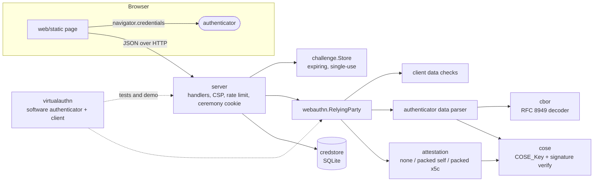

# passkeyd

A WebAuthn (passkey) relying-party library and HTTP server in Go, with its own
CBOR decoder, COSE key parser and a software authenticator for testing.

[](https://github.com/SlateGitOrg/passkeyd/actions/workflows/ci.yml)

## Why

Verifying a passkey is a long chain of byte-level checks: client data, origin
and RP ID binding, authenticator-data flags, COSE keys, attestation
certificates, signature counters. Most relying parties pull all of that in as
an opaque framework and only ever see "verification failed". passkeyd
implements the relying-party side in plain Go, with the CBOR and COSE parsers
in the repository, so each check can be read, fuzzed and tested on its own,
and every rejection carries a stable code (`origin_mismatch`,
`sign_count_regression`, ...) that says which attack it stopped. The only
third-party module is a pure-Go SQLite driver.

## Features

- **Registration:** attestation formats `none`, `packed` self attestation, and
  `packed` with an `x5c` certificate chain (WebAuthn L3 §8.2.1 certificate
  rules, AAGUID extension, optional trust-anchor chain verification).
- **Authentication:** RP ID hash, UP/UV flags, BE/BS backup-flag consistency,
  signature-counter clone detection, allow-list and user-handle binding.
- **Algorithms:** ES256, ES384, ES512, EdDSA (Ed25519), RS256. Ed448 is refused.
- **34 typed checks:** every rejection is a `*webauthn.VerifyError` with one
  `Check` code; tests assert the exact code, and a meta-test fails if any
  check has no negative test.
- **Hardened CBOR (RFC 8949):** depth, item and length limits, duplicate-key
  rejection in O(k), CTAP2 canonical encoding, diagnostic notation.
- **Expiring single-use challenge store:** a map plus a min-heap keyed by
  expiry, so `Put` and `Take` are O(log n).
- **SQLite credential store:** versioned migrations, atomic user+credential
  creation, compare-and-swap signature-counter updates, persistent clone flag.
- **HTTP server:** JSON API, strict CSP, HttpOnly/SameSite=Strict ceremony
  cookie, per-IP rate limiting, embedded framework-free browser demo page.
- **`virtualauthn`:** a software authenticator that creates real
  ES256/EdDSA/ES384/ES512/RS256 key pairs and emits CTAP2-canonical
  attestation objects, so tests and the demo run real cryptography with no
  browser.
- **Published vectors:** all 11 credential vectors from WebAuthn Level 3 §16
  and the 82 CBOR examples from RFC 7049/8949 Appendix A are replayed in the
  tests.
- **`passkeyd inspect`:** decodes attestation objects, authenticator data or
  any CBOR item from hex or base64url.

## Architecture



Imports only point downward. `cbor` and `cose` know nothing about WebAuthn.
`webauthn` knows nothing about HTTP or storage: it takes a `SessionData` and a
response and returns either a verified `Credential` or a `*VerifyError`, and
storage is passed in as two callbacks, so the library works with any
database. `server` wires the library to the challenge store, SQLite and the
embedded page. The ceremony state never leaves the server; the browser only
holds a random 256-bit key in a cookie.

[docs/ARCHITECTURE.md](docs/ARCHITECTURE.md) walks through both ceremony
pipelines check by check, the CBOR algorithm, the store design and the
complexity bounds. [docs/THREAT_MODEL.md](docs/THREAT_MODEL.md) maps 19
threats to mitigations and the tests that prove them.

## Quick start

Prerequisites:

- **Go 1.27 or newer.** `go.mod` declares `go 1.27`; an older `go` with the
  default `GOTOOLCHAIN=auto` downloads 1.27 on first use. No C compiler is
  needed (the SQLite driver is pure Go).
- **golangci-lint v2.15.0**, only for `make check` / `make lint`.
- **jq**, only for the `inspect` example below.

```sh
git clone https://github.com/SlateGitOrg/passkeyd.git
cd passkeyd

go build ./...        # compile every package
make test             # unit + integration tests under the race detector
make demo             # offline end-to-end demo: spec vectors, HTTP ceremonies, attacks
make build            # writes bin/passkeyd
./bin/passkeyd version
```

The full gate that CI runs:

```sh
go install github.com/golangci/golangci-lint/v2/cmd/golangci-lint@v2.15.0
make check            # gofmt check, go vet, golangci-lint, race tests, coverage >= 80%
```

To try a real passkey in a browser, run `make run` and open
<http://localhost:8080> in a browser that supports passkeys. WebAuthn treats
`localhost` as a secure context, so plain http works there. Register a
username, then sign in with or without typing it.

## Usage

### Command line

```text
passkeyd serve   [flags]            run the HTTP server (flags also read PASSKEYD_* env vars)
passkeyd demo    [-vectors path]    offline end-to-end demo with virtual authenticators
passkeyd inspect [-kind k] <data>   decode an attestation object, authenticator data or CBOR
                                    (<data> is hex or base64url; "-" reads stdin)
passkeyd version
```

Decoding the `none-es256` attestation object from the spec vectors:

```text
$ jq -r '.vectors["none-es256"].registration.attestationObject' testdata/webauthn-l3-vectors.json \
    | go run ./cmd/passkeyd inspect -
attestation object (194 bytes)
  fmt: none
  authenticator data (164 bytes)
    rpIdHash:  bfabc37432958b063360d3ad6461c9c4735ae7f8edd46592a5e0f01452b2e4b5
    flags:     0x59 UP|BE|BS|AT
    signCount: 0
    aaguid:    8446ccb9-ab1d-b374-750b-2367ff6f3a1f
    credentialId (32 bytes): -R85HbTJsv3g6nAYnLo_tj9Xm6YSKzOtlP8-wzAIS-Q
    publicKey: {1: 2, 3: -7, -1: 1, -2: h'afefa16f...', -3: h'930a56b8...'}
    publicKey.alg: ES256 (valid)
```

Running the server and starting a registration ceremony (headers and long
values trimmed):

```text
$ ./bin/passkeyd serve &
passkeyd 0.1.0 listening on http://127.0.0.1:8080 (RP ID "localhost", origins http://localhost:8080, db passkeyd.db)

$ curl -s localhost:8080/api/health
{"credentials":0,"pending_ceremonies":0,"status":"ok","users":0}

$ curl -s -i -X POST -H 'Content-Type: application/json' -d '{"username":"alice"}' \
    localhost:8080/api/register/options
HTTP/1.1 200 OK
Cache-Control: no-store
Content-Security-Policy: default-src 'self'; script-src 'self'; style-src 'self'; img-src 'self' data:; frame-ancestors 'none'; base-uri 'none'; form-action 'none'
Set-Cookie: passkeyd_ceremony=GZbVvkCd...; Path=/api/; Max-Age=300; HttpOnly; SameSite=Strict

{"rp":{"id":"localhost","name":"passkeyd"},"user":{"id":"EOIIRNRv...","name":"alice","displayName":"alice"},
"challenge":"A6CJe6-c...","pubKeyCredParams":[{"type":"public-key","alg":-7},{"type":"public-key","alg":-8},
{"type":"public-key","alg":-35},{"type":"public-key","alg":-36},{"type":"public-key","alg":-257}],
"timeout":300000,"excludeCredentials":[],"authenticatorSelection":{"residentKey":"required",
"requireResidentKey":true,"userVerification":"preferred"},"attestation":"none"}
```

The API is `POST /api/{register,login}/options`, `POST /api/{register,login}/verify`
and `GET /api/health`. For any host other than localhost, set the RP ID and
its exact origins (https is required):

```sh
./bin/passkeyd serve -rp-id example.org -origins https://example.org -db /var/lib/passkeyd.db
```

Every flag has a `PASSKEYD_*` environment variable; see
[.env.example](.env.example) for the full list (user verification,
attestation conveyance, trust anchors, device-bound policy, clone policy,
rate limit, logging).

### Library

```go
rp, _ := webauthn.New(webauthn.Config{RPID: "example.org", Origins: []string{"https://example.org"}})

opts, sess, _ := rp.BeginRegistration(webauthn.User{ID: handle, Name: "alice"}, nil)
// send opts to the browser; keep sess server-side (e.g. in a challenge.Store)
res, err := rp.FinishRegistration(sess, &browserResponse, credentialExists)
if webauthn.CheckOf(err) == webauthn.CheckOrigin { /* phishing attempt */ }
// persist res.Credential

lopts, lsess, _ := rp.BeginLogin(nil, nil) // discoverable passkey login
login, err := rp.FinishLogin(lsess, &assertion, lookupCredential)
// persist login.Credential with compare-and-swap on login.PreviousSignCount
```

### Offline demo

`make demo` replays the spec vectors, runs both ceremonies over real HTTP
against a temporary SQLite database, then tries the attacks the checks exist
for. Output from a real run (loopback port replaced with `PORT`):

```text
== 1. WebAuthn Level 3 spec vectors (section 16) ==
  PASS  verified  none-es256                     ES256  attestation=none  trusted=false  credIdLen=32
  PASS  verified  none-es256-crossOrigin         ES256  attestation=none  trusted=false  credIdLen=32
  PASS  verified  none-es256-long-credential-id  ES256  attestation=none  trusted=false  credIdLen=1023
  PASS  verified  none-es256-topOrigin           ES256  attestation=none  trusted=false  credIdLen=32
  PASS  refused   packed-ed448                   Ed448 is not implemented -> algorithm_not_allowed
  PASS  verified  packed-eddsa                   EdDSA  attestation=basic  trusted=true  credIdLen=32
  PASS  verified  packed-es256                   ES256  attestation=basic  trusted=true  credIdLen=32
  PASS  verified  packed-es384                   ES384  attestation=basic  trusted=true  credIdLen=32
  PASS  verified  packed-es512                   ES512  attestation=basic  trusted=true  credIdLen=32
  PASS  verified  packed-rs256                   RS256  attestation=basic  trusted=true  credIdLen=32
  PASS  verified  packed-self-es256              ES256  attestation=self  trusted=false  credIdLen=32

== 2. Ceremonies over HTTP (server http://127.0.0.1:PORT, RP ID "localhost", origin http://localhost:8080, SQLite demo.db) ==
  PASS  accepted  register alice  packed x5c / ES256  algorithm=ES256  attestation=basic  trusted=true
  PASS  accepted  register bob    none / EdDSA  algorithm=EdDSA  attestation=none
  PASS  accepted  register carol  packed self / synced  attestation=self  backupEligible=true
  PASS  accepted  login alice     by username  username=alice  signCount=2
  PASS  accepted  login alice     again, counter grows  signCount=3
  PASS  accepted  login bob       discoverable  username=bob  userVerified=true
  PASS  accepted  login carol     zero counter is fine  username=carol  signCount=0  backupState=true

== 3. Attacks that must be refused ==
  PASS  refused   phishing origin       client on evil origin -> HTTP 401 origin_mismatch
  PASS  refused   duplicate username    register alice again -> HTTP 409 username_taken
  PASS  refused   replay, same cookie   resubmit a used response -> HTTP 400 session_invalid
  PASS  refused   replay, new ceremony  captured response vs fresh challenge -> HTTP 401 challenge_mismatch
  PASS  refused   tampered signature    flip one signature bit -> HTTP 401 signature_invalid
  PASS  refused   expired ceremony      answer after 6 minutes -> HTTP 400 session_invalid
  PASS  refused   wrong RP ID           credential minted for another site -> HTTP 400 rp_id_hash_mismatch
  PASS  accepted  login alice           original authenticator  signCount=8
  PASS  refused   cloned authenticator  copy replays an old counter -> HTTP 401 sign_count_regression

== 4. Stored state ==
  users=3 credentials=3
  alice  ES256  attestation=basic  signCount=8  BE=false  cloneWarning=true
  bob    EdDSA  attestation=none   signCount=2  BE=false  cloneWarning=false
  carol  ES256  attestation=self   signCount=0  BE=true   cloneWarning=false
  PASS  flagged  clone detection persisted  alice's credential carries clone_warning=1

Summary: 28 expectations met, 0 failed, 10 spec vectors verified
```

The authenticators in sections 2 and 3 are software (`virtualauthn`), and the
"expired ceremony" step moves a simulated clock forward rather than waiting.
The cryptography, CBOR, HTTP, cookies and SQLite are all real.

## How it works

The full list of decisions, each with what it costs if it turns out to be
wrong, is in [DECISIONS.md](DECISIONS.md). The ones that shape the code most:

- **Parsers stay in the repository.** CBOR and COSE are where WebAuthn
  libraries have historically had bugs, so passkeyd writes them itself,
  bounds them, and fuzzes them (`make fuzz`). Before a string, array or map is
  allocated, its declared length is compared with the remaining input, so a
  9-byte input claiming 2^63 elements fails without allocating.
- **The CBOR profile is strict where ambiguity is dangerous.** It rejects
  duplicate keys (switching to a hash set at 16 entries, so a hostile map
  costs O(k), not O(k²)), indefinite lengths, trailing bytes and invalid
  UTF-8. It does not enforce canonical key order, because honest
  authenticators sometimes break that rule.
- **Hostile tests are validly signed.** Negative tests build responses with
  hooks on the virtual authenticator (`AuthDataHook`, `CertHook`,
  `ClientDataHook`), so each one is correctly signed and breaks exactly one
  rule. A check that is only reached through a broken signature proves
  nothing.
- **Ceremony state never leaves the server.** The browser holds only a
  random 256-bit key in an HttpOnly, SameSite=Strict cookie scoped to
  `/api/`. `Take` removes the entry before checking expiry, so each challenge
  works exactly once.
- **Clone detection rejects by default.** A counter that goes backwards fails
  the login and the credential is flagged in the database. A counter of 0 on
  both sides is how synced passkeys behave, so it is not treated as a clone.
  Counter updates are `UPDATE ... WHERE id = ? AND sign_count = ?`, so two
  concurrent logins cannot both succeed against the same stored counter.
- **Login does not enumerate accounts.** Login options never list
  credentials, whatever username is sent. A supplied username is bound
  through the session's user handle instead (an unknown name gets a random
  handle that owns nothing), which is why the server requires discoverable
  credentials (`ResidentKey: required`).
- **Attestation is permissive by default.** Consumer passkey sites request
  `none`. An x5c chain is checked for structure and signature, and is marked
  `trusted` only when trust anchors are configured (`-trust-anchors`,
  `-require-trusted`).

## Testing

```sh
make test                                   # all tests, race detector on
make cover                                  # coverage gate over the core packages (>= 80%)
go test -run TestSpecVectors ./webauthn/    # WebAuthn L3 §16 vectors
make fuzz FUZZTIME=15s                      # 4 fuzz targets
make bench                                  # CBOR, ceremony and challenge-store benchmarks
```

| What | Command | Result |
|---|---|---|
| All gates | `make check` | passes: gofmt, vet, golangci-lint (0 issues), race tests, coverage |
| Core coverage | `./scripts/coverage.sh` | **96.0%** of statements in cbor, cose, webauthn, challenge, credstore, server, virtualauthn |
| Spec vectors | `go test -run TestSpecVectors ./webauthn/` | 10 of 10 accepted (registration, then authentication, then a tampered-signature rejection); Ed448 refused |
| CBOR examples | `go test -run TestAppendixA ./cbor/` | 82 of 82 handled (81 decoded and compared, plus `simple(24)` rejected per RFC 8949) |
| Negative checks | `go test -run 'TestNegativeChecks\|TestEveryCheck' ./webauthn/` | 84 hostile cases covering all 34 checks |
| Concurrency | `go test -race -run TestConcurrent ./challenge/ ./credstore/` | 64 goroutines racing `Take` on one challenge: exactly one wins. 16 counter updates from the same stored value: exactly one applies |
| Fuzzing | `make fuzz FUZZTIME=15s` | 4 targets, no failures. Execs in one 15 s run each: `FuzzDecode` 1.63M, `FuzzParseKey` 2.76M, `FuzzParseAuthenticatorData` 1.24M, `FuzzFinishRegistration` 1.04M |
| Lines of code | `./scripts/loc.sh` | non-test Go: 5,397 lines (4,442 code). Tests: 3,335 lines. Static page: 204 lines |

The coverage gate is measured with `-coverpkg` over the security-relevant
packages, so tests in one package count for another; `cmd/` and `internal/`
have their own tests but are outside the gate.

`make bench` on an Apple M1 Pro (darwin/arm64, Go 1.27.1). These are single
runs, so treat the numbers as rough:

```text
BenchmarkDecodeAttestationObject-8            3103652     387.6 ns/op   500.51 MB/s    896 B/op    1 allocs/op
BenchmarkEncodeCanonical-8                    2532979     471.3 ns/op                 1264 B/op   16 allocs/op
BenchmarkPutTake-8                            1899889     641.7 ns/op                  192 B/op    4 allocs/op
BenchmarkFinishRegistrationNoneES256-8         398446      2993 ns/op                 4250 B/op   30 allocs/op
BenchmarkFinishRegistrationPackedX5CES256-8     16869     71452 ns/op                11029 B/op  125 allocs/op
BenchmarkFinishRegistrationNoneEdDSA-8         463180      2485 ns/op                 3569 B/op   24 allocs/op
BenchmarkFinishLoginES256-8                     19206     64038 ns/op                 3589 B/op   32 allocs/op
BenchmarkFinishLoginEdDSA-8                     26341     44971 ns/op                 2364 B/op   16 allocs/op
BenchmarkFinishLoginRS256-8                     36902     32603 ns/op                 4062 B/op   28 allocs/op
```

Registration with `none` attestation involves no signature check, so it
measures parsing and key validation only. Login cost is mostly one signature
verification. `PutTake` runs against a store pre-filled with 100,000 entries.

## Project layout

```text
cbor/            RFC 8949 decoder/encoder, limits, canonical mode, diagnostic notation
cose/            COSE_Key parsing/encoding (EC2, OKP, RSA) and signature verification
webauthn/        relying party: options, client data, authenticator data, attestation, both ceremonies
challenge/       generic expiring, single-use Store[T] (map + min-heap)
credstore/       SQLite repository: migrations, atomic registration, CAS counter updates
server/          HTTP JSON API, security headers, per-IP rate limiting
virtualauthn/    software authenticator and client for tests and the demo
web/static/      browser demo page (HTML, JS, CSS; embedded into the binary)
cmd/passkeyd/    CLI entry point
internal/cli/    serve, demo, inspect, version
internal/demo/   the offline end-to-end scenario behind `make demo`
testdata/        frozen WebAuthn L3 §16 vectors and CBOR Appendix A examples (see DATA.md)
scripts/         coverage gate, line counts, spec-vector extraction
docs/            ARCHITECTURE.md, THREAT_MODEL.md
```

## Limitations

- **Attestation formats:** only `none` and `packed` are implemented. A
  response in `tpm`, `android-key`, `android-safetynet`, `apple` or
  `fido-u2f` format is rejected with `attestation_format_unsupported`. That
  matters only if you request `direct` attestation; browsers send `none` by
  default.
- **No FIDO Metadata Service:** trust comes only from anchors you supply.
  Basic and AttCA attestation are both reported as `basic`.
- **Ed448 is not supported**, because the Go standard library has no
  implementation and passkeyd avoids third-party crypto.
- **Single node:** the challenge store is in process memory. Ceremonies in
  flight are lost on restart, and running several replicas would need a
  shared store.
- **The server is the RP core, not an identity product.** It does not issue a
  login session after a successful assertion, has no account recovery, and
  cannot add a second passkey to an existing account; the library supports
  that, but the HTTP flow would need an authenticated session.
- **Clone detection is weak for synced passkeys.** They report a counter of 0,
  so the counter check gives no signal for them; this is inherent to such
  authenticators.
- **Rate limiting** is per TCP peer IP and in memory. Behind a reverse proxy,
  all clients share one bucket, because `X-Forwarded-For` is deliberately
  ignored.
- **Browser demo:** the static page is served by the tested server and passes
  `node --check`, but the automated end-to-end runs all use the software
  authenticator rather than a hardware one.
- **Spec vectors** come from the W3C editor's draft and are frozen in
  `testdata/`; they are not re-fetched by the tests (see [DATA.md](DATA.md)).
- **Not audited:** the code has had no external security review and has no
  production deployments. Treat it as a reference implementation.

## Roadmap

1. `tpm`, `android-key` and `apple` attestation formats, plus FIDO MDS3 blob
   verification for trust anchors.
2. A pluggable challenge store backed by SQLite or Redis, for multi-instance
   deployments.
3. Authenticated sessions after login, so the server can add passkeys to
   existing accounts and remove them (`excludeCredentials` is already wired).
4. Extensions: `credProps`, `largeBlob` and `prf` passthrough, and conditional
   mediation (autofill) in the demo page.
5. A trusted-proxy setting for the client IP used by rate limiting.

## License

MIT — see [LICENSE](LICENSE). The test vectors carry their own terms; see
[DATA.md](DATA.md).
