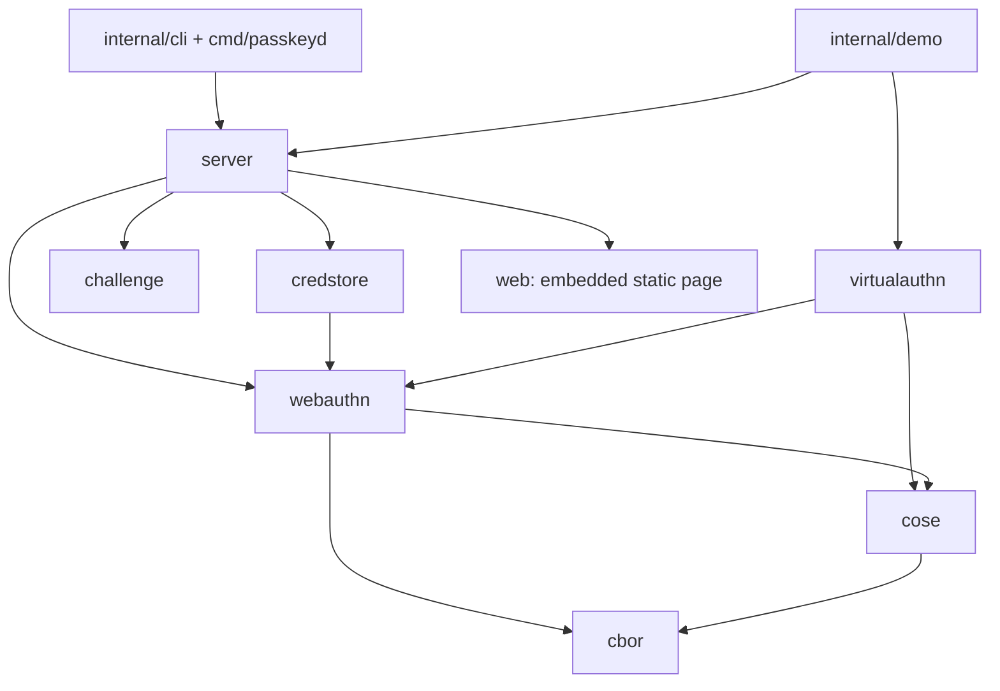
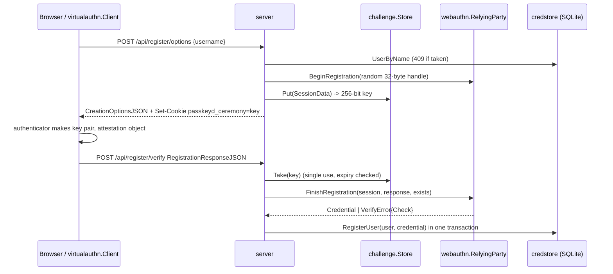

# Architecture

This document follows the bytes: how a registration and a login response travel
through passkeyd, which component checks what, and what each step costs.

## Layering

Imports only point downward. `cbor` and `cose` know nothing about WebAuthn.
`webauthn` knows nothing about HTTP or storage: it takes a `SessionData` and a
response, and returns either a verified `Credential` or a `*VerifyError`.
Storage is passed in as two callbacks (`CredentialExistsFunc` and
`CredentialLookupFunc`), so the library works with any database.

## Registration pipeline (WebAuthn L3 §7.1)

`FinishRegistration` runs these checks in order. Each step can fail with exactly one `Check`:

| # | Step | Check on failure |
|---|---|---|
| 1 | Session exists, is a registration, and has not expired | `session_invalid` |
| 2 | `type == "public-key"`, `id == base64url(rawId)`, rawId not empty | `response_malformed` |
| 3 | clientDataJSON parses as JSON | `client_data_malformed` |
| 4 | `type == "webauthn.create"` | `client_data_type` |
| 5 | challenge is strict base64url and matches the session (constant-time compare) | `challenge_mismatch` |
| 6 | origin is in the configured exact list | `origin_mismatch` |
| 7 | `crossOrigin` is allowed; `topOrigin` is only present when cross-origin, and is in the allowed list | `cross_origin_not_allowed`, `top_origin_mismatch` |
| 8 | attestationObject is a CBOR map of exactly `fmt`/`attStmt`/`authData` with the right types | `attestation_object_malformed` |
| 9 | authenticator data parses (lengths, COSE key, extensions, no trailing bytes) | `authenticator_data_malformed`, `credential_id_length` |
| 10 | rpIdHash == SHA-256(RP ID); UP is set; UV is set if required; BS is not set without BE; BE is refused if policy requires device-bound keys | `rp_id_hash_mismatch`, `user_not_present`, `user_not_verified`, `backup_flags_inconsistent`, `backup_policy` |
| 11 | AT flag set, credential ID not empty and equal to rawId | `attested_credential_data`, `credential_id_mismatch` |
| 12 | COSE key valid (point on curve, sizes) and algorithm both supported and requested | `public_key_invalid`, `algorithm_not_allowed` |
| 13 | attestation statement: format, syntax, signature, certificate rules, AAGUID, trust, policy | `attestation_*`, `aaguid_mismatch` |
| 14 | credential ID not already registered | `credential_already_registered` |

## Authentication pipeline (WebAuthn L3 §7.2)

| # | Step | Check on failure |
|---|---|---|
| 1 | Session exists, is an authentication, and has not expired | `session_invalid` |
| 2 | Response shape | `response_malformed` |
| 3 | Credential is in `allowCredentials` (when the session lists any) | `credential_not_allowed` |
| 4 | Credential exists | `credential_unknown` |
| 5 | Session user owns it; a returned userHandle owns it; a discoverable login carries a userHandle | `user_handle_mismatch` |
| 6 | Client data (`webauthn.get`, challenge, origin, cross-origin rules) | as in registration |
| 7 | Authenticator data parses; AT flag is not set in an assertion | `authenticator_data_malformed` |
| 8 | rpIdHash, UP, UV, BS/BE consistency, backup policy | as in registration |
| 9 | BE matches the stored value (BE is fixed when the credential is created) | `backup_eligibility_changed` |
| 10 | Stored key parses; signature over `authData ‖ SHA-256(clientDataJSON)` verifies | `public_key_invalid`, `signature_invalid` |
| 11 | Counter: if either counter is non-zero, the new value must be greater than the stored one | `sign_count_regression` (or `CloneWarning` under `CloneFlag`) |

Success returns the updated credential and `PreviousSignCount`. The server
persists them with `UPDATE ... WHERE id = ? AND sign_count = ?`. If two
concurrent logins verified against the same stored counter, only one update
applies, and the other gets HTTP 409 `concurrent_login`.

## CBOR decoder

The decoder is a recursive descent parser over a byte slice. Its state is just
an offset and an item counter.

- **Header decoding:** the initial byte splits into a major type (3 bits) and
  additional information (5 bits). The argument is either inline (<24) or 1, 2,
  4 or 8 big-endian bytes; 28–30 are reserved and rejected. In canonical mode,
  any argument not in its shortest form is rejected.
- **Allocation safety:** before a string, array or map is allocated, the
  declared length is compared with the remaining input. A byte string needs n
  bytes, an array at least n bytes, a map at least 2n bytes. So a 9-byte input
  that claims 2^63 elements fails without allocating anything.
- **Limits:** nesting depth (default 16) and total item count (default 65,536)
  are enforced. Text strings must be valid UTF-8. Simple values below 32 in the
  two-byte form are rejected, as RFC 8949 §3.3 requires.
- **Duplicate keys:** maps with fewer than 16 entries are checked by linear
  scan with `Equal`. Larger maps switch to a hash set keyed by each key's
  preferred serialization, which is equal exactly when `Equal` says the keys
  are equal. A hostile map of k distinct keys therefore costs O(k), not O(k²).
  `TestLargeMapDuplicateDetection` decodes 20,000 keys in about 10 ms.
- **Raw bytes are kept:** every decoded `Value` keeps the slice of input it
  came from (`Raw()`). WebAuthn needs this: the COSE key is stored exactly as
  the authenticator encoded it, and `DecodeFirst` reports where the key ends
  inside authenticator data, so the extension map can be found after it.
- **Encoding:** `Encode` produces the preferred serialization: shortest
  arguments, definite lengths, and the shortest float width that is exact (half
  floats are converted by hand, including subnormals). `EncodeCanonical` also
  sorts map keys in CTAP2 order (shorter encoded key first, then bytewise);
  the virtual authenticator uses it.

Complexity: decoding is O(n) time in the input size, plus O(k) expected time
per map for duplicate detection. Space is O(n) for the value tree, and stack
depth is bounded by `MaxDepth`.

## COSE keys and signatures

`KeyFromValue` requires `kty` and `alg` (WebAuthn makes `alg` mandatory) and
checks that they agree: EC2 needs `crv` 1/2/3 to match ES256/384/512, OKP
needs Ed25519 with alg -8 or -19, RSA needs RS256 with a 2048–8192-bit modulus
and an odd exponent. EC points are validated by
`ecdsa.ParseUncompressedPublicKey`, which rejects off-curve points and the
point at infinity. ECDSA signatures must be ASN.1 DER, because WebAuthn does
not use raw `r‖s`. Ed448 parses as `ErrUnsupportedAlgorithm`.

## Packed attestation

- **Self attestation:** there is no `x5c`. `alg` must equal the credential's
  algorithm, and the credential key verifies the signature.
- **Basic attestation:** `x5c[0]` verifies the signature with `alg` (the
  leaf's key type must match `alg`). Then the §8.2.1 rules apply: X.509 v3;
  exactly one two-letter C; an O; OU equal to the literal "Authenticator
  Attestation"; a non-empty CN; the certificate is not a CA; and the AAGUID
  extension, if present, is non-critical, a 16-byte OCTET STRING, and equal to
  the AAGUID in authenticator data. With trust anchors configured, the chain
  (`x5c[1:]` as intermediates) must verify at `Config.Now()`.

## Challenge store

`challenge.Store[T]` combines a `map[key]*entry` with a binary min-heap of the
same entries ordered by expiry. Each entry records its heap index, so `Take`
can remove an entry from the middle of the heap in O(log n).

| Operation | Time | Notes |
|---|---|---|
| `Put` | O(log n) amortized | Pops expired entries off the heap top first, then rejects with `ErrFull` at capacity |
| `Take` | O(log n) | Removes the entry before checking expiry, so an expired key cannot be retried |
| `Sweep` | O(k log n) | k = number of expired entries |

Keys are 32 bytes from `crypto/rand`, base64url encoded (43 characters).
`TestHeapInvariantRandomOps` checks the heap order and index invariants
against a model over 20,000 random operations, and
`TestConcurrentTakeIsExactlyOnce` checks that 64 racing `Take` calls produce
exactly one winner.

## Persistence

The SQLite database is opened through `modernc.org/sqlite`, a pure-Go driver,
with `foreign_keys=on`, `busy_timeout=5000`, WAL mode and synchronous=NORMAL.
Migrations are versioned with `PRAGMA user_version`; a database whose version
is newer than the binary is refused. `RegisterUser` inserts the user and the
first credential in one transaction, so a failed or concurrent registration
never leaves an account without a credential.

## HTTP layer

The middleware stack, from the outside in, is: recover, then access log, then
security headers, then the router. The routes are:

- `GET /`: the embedded static files.
- `POST /api/{register,login}/options`: rate limited, JSON content type
  required.
- `POST /api/{register,login}/verify`: JSON content type required.
- `GET /api/health`.

Login options never list credentials, whatever username is sent, so the
response does not reveal whether an account exists. A supplied username is
bound through the session's user handle (a random one for an unknown name),
and step 5 of the authentication checks above rejects any credential that
handle does not own. The server therefore requires `ResidentKey: required`.

Bodies are capped at 64 KiB and must contain exactly one JSON value. The
ceremony cookie is HttpOnly, SameSite=Strict, scoped to `Path=/api/`, and
uses a relative `MaxAge`. It is Secure whenever an https origin is configured.
The rate limiter is a token bucket per peer IP; buckets idle for longer than
the window are dropped during periodic sweeps.

## Virtual authenticator

`virtualauthn.Authenticator` keeps credentials in memory. For each credential
it holds an RP ID, a user handle, the algorithm, a `crypto.Signer` and a
counter. `MakeCredential` builds authenticator data byte by byte and attests in
one of three ways:

- `none`;
- packed self, signed with the credential key;
- packed x5c, signed by an ES256 attestation key whose certificate is issued by
  a per-authenticator root CA (`AttestationRoot()` returns it for use as a
  trust anchor).

Hooks (`AuthDataHook`, `CertHook`, `Client.ClientDataHook`) let the tests
produce responses that are validly signed but do not conform. `Clone()`
copies the private keys and counters, which models an extracted authenticator.
